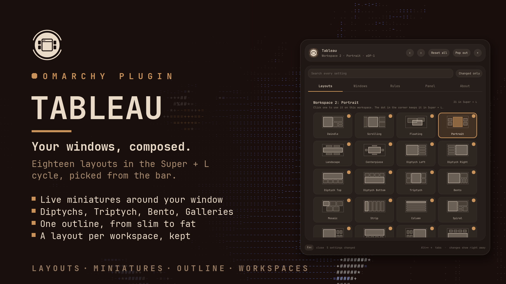
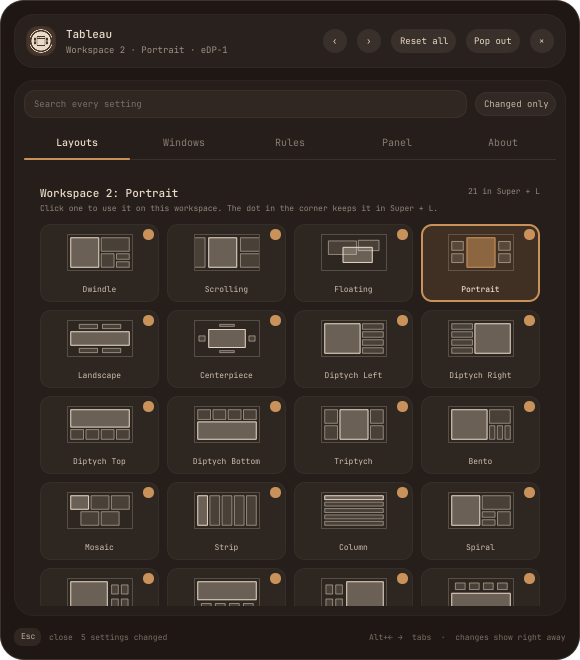
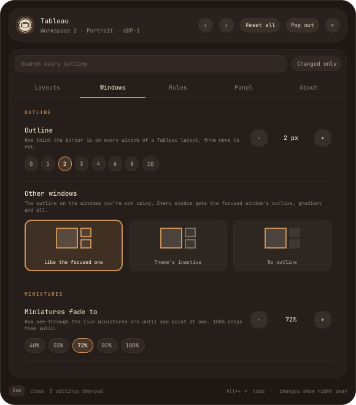
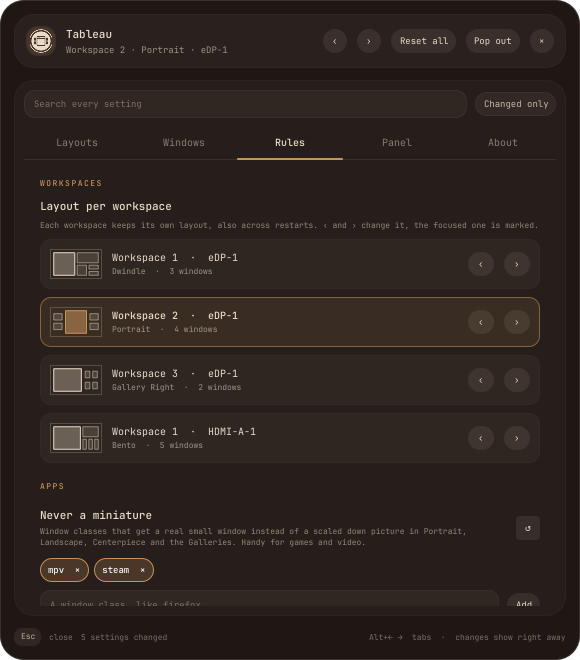
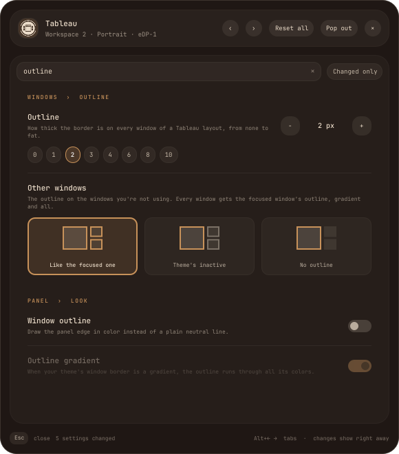
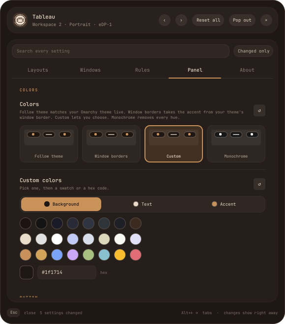
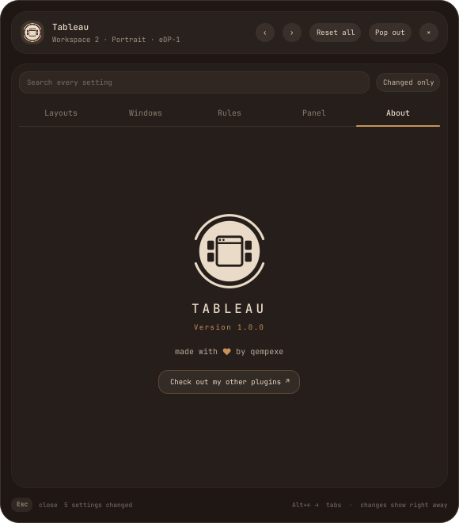
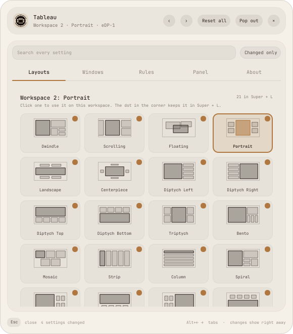

<p align="center">
  <picture>
    <source media="(prefers-color-scheme: light)" srcset="assets/logo-dark.png">
    
  </picture>
</p>

<h1 align="center">Tableau</h1>

<p align="center">Eighteen window layouts for <a href="https://omarchy.org">Omarchy</a>, in the same <b>Super + L</b> cycle as Dwindle, Scrolling and Floating, with a bar button to pick them.</p>



Tableau adds its layouts to Hyprland and to Omarchy's workspace layout cycle. Each
workspace keeps its own layout, through Omarchy's own workspace modes, so a choice
survives a shell restart, a logout and a reboot. On a second monitor, workspace 1 and
the first monitor's workspace 1 keep layouts of their own.

The button on the bar shows the focused workspace's layout. Its panel has every layout
as a picture to click, the window outline from slim to fat, which layouts **Super + L**
goes through, and every workspace with its layout.

## Features

- **Live miniatures**: in Portrait, Landscape, Centerpiece and the four Galleries, the
  window you use stays large and the others keep running as true miniatures around it.
  A miniature is the window at its normal size drawn small, never squashed.
- **Eighteen layouts**: Portrait, Landscape, Centerpiece, four Diptychs, Triptych, Bento,
  Mosaic, Strip, Column, Spiral, four Galleries and Spread.
- **One outline for every window**: as thick as you like, and the windows you're not
  using can wear the focused window's outline, your theme's inactive one, or none.
- **Your own Super + L**: leave out the layouts you never use.
- **A layout per workspace**, kept across restarts, and set from the panel for any
  workspace on any monitor.
- **Keys that know the layout**: Super + arrows, Super + Shift + arrows, Alt + Tab,
  Super + Z and the resize keys work on the window positions Tableau draws.
- **Settings in the house style**: a bar panel or its own window, a search over every
  tab, colors that follow your theme or its window border, and an About tab.

### The layouts



| Layout | What it does |
| --- | --- |
| Portrait | the window you use in the middle, live miniatures at the sides |
| Landscape | a wide window in the middle, miniatures above and below |
| Centerpiece | the window in the middle, miniatures on all four sides |
| Diptych Left, Right, Top, Bottom | a large pane, the rest stacked beside it |
| Triptych | the window you use in the middle, the rest stacked on either side |
| Bento | a large pane, one window beside it, the rest in a row below that |
| Mosaic | equal tiles in the grid that suits the screen best |
| Strip, Column | side by side, or one above the other |
| Spiral | each window halves the space that's left |
| Gallery Right, Bottom, Left, Top | a large pane, live miniatures in a grid |
| Spread | a grid with room between the tiles |

Click a picture to use that layout on the focused workspace. The dot in a tile's corner
keeps it in **Super + L** or leaves it out.

<br clear="right">

### The outline



**Outline** sets the border on every window of a Tableau layout, from none to 10 px.
**Other windows** picks what the windows you're not using wear: the focused window's
outline (its gradient included), your theme's inactive border, or no outline at all.

**Miniatures fade to** sets how see-through the live miniatures are until you point at
one, and **Light up a swap** flashes both windows when two trade places. The **Sizes**
set the main pane of the Diptychs and Bento, the middle of Triptych, how much one
press of the resize keys changes, and the gap in
Spread.

<br clear="right">

### Workspaces



The Rules tab lists every workspace and the empty ones with a saved layout, the
focused one marked. **‹** and **›** step that workspace through the layouts.

**Never a miniature** lists window classes that get a real small window instead of a
miniature: games, video, anything that minds being drawn small.

<br clear="right">

## Installation

```bash
omarchy plugin add https://github.com/qempexe/omarchy-tableau.git --enable --yes
omarchy restart shell
```

The layouts are there as soon as the plugin is on. To have the button, place it with
the bar settings, or write `{ "id": "io.github.qempexe.tableau" }` into `bar` →
`layout` in `~/.config/omarchy/shell.json`.

The live miniatures come from a small Hyprland plugin that Tableau builds for your
Hyprland version the first time, and again after a Hyprland update. That needs
the `base-devel` package group. Without it, the thumbnail layouts
still work, with the other windows resized into their spots.

## Usage

### Keys

| Keys | Result |
| --- | --- |
| Super + L | the next layout in your cycle |
| Super + Shift + L or Super + Alt + L | the previous one |
| Super + Ctrl + L, then 1 – 9 | Dwindle, Scrolling, Floating, Portrait, Landscape, Centerpiece, Diptych Left, Diptych Right, Mosaic |
| Super + Ctrl + L, 0, then 1 – 0, -, = | Strip, Column, Spiral, Gallery Right, Gallery Bottom, Gallery Left, Gallery Top, Spread, Diptych Top, Diptych Bottom, Triptych, Bento |
| Super + arrows | focus the nearest window that way |
| Super + Shift + arrows | swap with the nearest window that way |
| Alt + Tab | step through the windows; let go of Alt to bring that one forward |
| Super + Z | bring the focused window forward |
| Super + - and = | grow or shrink the main window, or the focused tile, a small step at a time; hold to keep going (Alt: finer, Ctrl: coarser) |

On a Tableau layout, Super + arrows only moves the focus, so you can type into a
miniature without bringing it forward. A click brings it forward.

### Clicking the button

| Mouse | Result |
| --- | --- |
| Left | the panel |
| Right | the next layout, the previous one, or nothing |
| Middle | the previous layout, the next one, or nothing |

Right and middle click are set under **Panel** › **Button**.

### From a terminal

```bash
omarchy-shell io.github.qempexe.tableau layouts        # open the Layouts tab (again to close)
omarchy-shell io.github.qempexe.tableau settings       # open the settings
omarchy-shell io.github.qempexe.tableau next           # the next layout (also: back)
omarchy-shell io.github.qempexe.tableau set bento      # a layout by name
omarchy-shell io.github.qempexe.tableau status         # the focused workspace and its layout, as json
```

## Configuration



Every change shows at once and is saved to `~/.config/omarchy/tableau.json`. The file
is watched, so a hand edit applies live too, and odd values fall back to their
defaults. **Alt+←** and **Alt+→** step through the five tabs, the search box looks
through all of them, and **Changed only** shows what differs from the defaults.

- **Layouts**: every layout to click, which ones Super + L goes through, and the
  notification when the layout changes.
- **Windows**: the outline, the other windows' outline, the miniatures, and the sizes.
- **Rules**: every workspace with its layout, and the never-a-miniature list.
- **Panel**: colors (Follow theme, Window borders, Custom, Monochrome), the button and
  its clicks, and the panel's size, spacing, roundness, outline, text size and opacity.
- **About**: the version, and more plugins.

<br clear="right">

<table>
<tr>
<td></td>
<td></td>
<td></td>
</tr>
<tr>
<td></td>
<td></td>
<td></td>
</tr>
</table>

## Troubleshooting

- **How it works.** The layouts are Hyprland Lua layouts, loaded with `hyprctl eval`
  when the shell starts and again after every config reload. A layout choice is an
  Omarchy workspace mode, saved in `~/.local/state/omarchy/workspace-layouts/`. The
  panel's layout settings go to `~/.local/state/hypr-tableau/settings.conf`, plain
  `key=value` lines that the layouts read without running anything.
- **Miniatures are just small windows.** The thumbnail helper isn't built: install
  `base-devel` and restart the shell. Its build log is
  `hypr/stagethumbs/build.log` in the plugin folder.
- **Games.** A game running through XWayland asks Hyprland for a size again and again,
  and each time Hyprland puts the focus on whatever is under the pointer. While an X11
  window is open, Tableau promotes a window on a press of a mouse button only, and gives
  the focus back to the window that had it. A tap on a touchscreen promotes nothing
  then; **Super + Z** does.
- **An app looks wrong as a miniature.** Put its class on **Never a miniature**
  (Rules). `hyprctl clients` shows the class.
- **A layout misbehaves.** Errors from the layouts are kept in
  `~/.local/state/hypr-tableau/errors.log`, with a traceback.
- **Turning Tableau off** reloads Hyprland's config: workspaces that had a Tableau
  layout fall back to Hyprland's default, and the thumbnail helper is unloaded.
- Tableau runs `hyprctl` to load its layouts and read the workspaces, and nothing else.
  It makes no network requests, and only writes its settings, `settings.conf`, the
  main window sizes you set with the keys, and Omarchy's workspace layout files.

## Contributing

Bug reports and ideas are welcome as [issues](https://github.com/qempexe/omarchy-tableau/issues). [CONTRIBUTING.md](CONTRIBUTING.md) describes how the code fits together and how to test it. Everyone taking part is expected to follow the [code of conduct](CODE_OF_CONDUCT.md). What changed in each version is in the [changelog](CHANGELOG.md).

### Source layout

```
hypr/
├── tableau.lua          the layouts, the outline rules and the keys on a layout
├── tableau-service.sh   loads them, builds and loads the thumbnail helper
└── stagethumbs/         the thumbnail helper, a Hyprland plugin
tableau.lua              the layout cycle keys and saved layouts
cycle_layout.py          changes and saves a workspace's layout, and lists them
qml/
├── Service.qml          the settings, settings.conf, the workspaces and the ipc
├── BarWidget.qml        the bar button
├── core/                SettingsStore (tableau.json), UiState (colors, sizes)
├── panel/               Panel, PopoutWindow, PanelView, SettingsView, SettingRow,
│                        LayoutGrid, LayoutArt, WorkspacesPage, TileArt, AboutPage
├── controls/            Btn, Chip, Sw, Txt, TextBox
└── js/                  Schema.js (every setting), Layouts.js (the layouts and their
                         pictures), Theme.js, Util.js
tests/                   the layouts in Lua 5.5, settings.conf, the cycle, the schema
```

## Credits

Portrait and Landscape, and the thumbnail helper, adapt the Stage layout from
[omarchy-stage](https://github.com/Sulejman/omarchy-stage) by Sulejman Sarajlija,
under the MIT license.

## License

[MIT](LICENSE)
